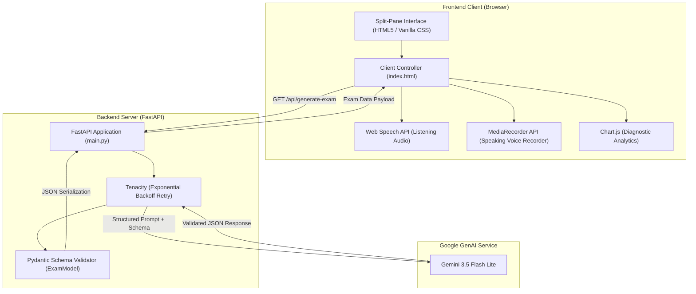

# IELTS 4-Skill Computer-Delivered Mock System

[](https://www.python.org/)
[](https://fastapi.tiangolo.com/)
[](https://ai.google.dev/)
[](https://www.uvicorn.org/)
[](https://www.chartjs.org/)
[](https://opensource.org/licenses/MIT)

An AI-powered, full-exam IELTS Academic computer-delivered testing simulator. The application dynamically generates structured mock tests across all four core language skills (**Listening**, **Reading**, **Writing**, and **Speaking**) via the Google Gemini API, enforces strict schema validation using Pydantic, and provides instant scoring and band diagnostics visualized with Chart.js.

---

## Table of Contents

- [Features](#features)
- [Architecture](#architecture)
- [Project Structure](#project-structure)
- [Prerequisites](#prerequisites)
- [Installation Instructions](#installation-instructions)
- [Running the Server](#running-the-server)
- [How to Use](#how-to-use)
- [API Reference](#api-reference)
- [Scoring Methodology](#scoring-methodology)
- [License](#license)

---

## Features

- **Dynamic Exam Generation**: Generates randomized, unique IELTS Academic exams using `gemini-3.5-flash-lite` with schema-enforced structured JSON output.
- **Resilient AI Pipeline**: Implements exponential backoff retries via `tenacity` to guarantee robust generation without malformed JSON errors.
- **Split-Screen Exam Environment**: Realistic computer-delivered IELTS layout with reading/passage materials on the left and questions/input on the right.
- **Listening Module**: Text-to-speech audio simulation powered by the browser's Web Speech API with note-taking display and comprehension questions.
- **Reading Module**: Academic reading passages with tagged paragraphs and True/False/Not Given (TFNG) / Multiple Choice questions.
- **Writing Module**: Academic Task 2 essay workspace with a live word counter highlighting the 250-word minimum threshold.
- **Speaking Module**: Part 2 Cue Card prompt, 1-minute preparation timer, in-browser voice recorder (`MediaRecorder` API) with instant playback, and self-assessment checklist.
- **Diagnostic Score Dashboard**: Computes section bands and overall band using the official IELTS rounding formula, benchmarked against a Target Band 7.0 line on an interactive Chart.js bar chart.

---

## Architecture

The system follows a lightweight, decoupled client-server architecture:



### Component Breakdown

1. **FastAPI Backend (`main.py`)**:
   - Serves the frontend single-page interface at `GET /`.
   - Exposes `GET /api/generate-exam` to handle dynamic test creation.
   - Enforces response typing through nested Pydantic models (`ExamModel`, `ListeningSection`, `ReadingSection`, `WritingSection`, `SpeakingSection`, `Question`, `Paragraph`).
   - Uses `tenacity` retry logic (up to 4 attempts with exponential backoff) for resilience against network or API throttling.
2. **Frontend Engine (`index.html`)**:
   - Single-file zero-dependency interface leveraging native modern browser APIs.
   - Handles tab navigation across the 4 skills and results dashboard.
   - Uses the Web Speech API (`SpeechSynthesisUtterance`) to synthesize lecture audio on-the-fly.
   - Uses `navigator.mediaDevices.getUserMedia` and `MediaRecorder` for capturing spoken audio responses.
   - Renders performance comparison graphs with `Chart.js`.
3. **Reference Data (`data.json`)**:
   - Contains fallback / reference structure for IELTS Academic Reading passages and TFNG questions.

---

## Project Structure

```text
.
├── main.py              # FastAPI application & Gemini API integration
├── index.html           # Full computer-delivered UI, audio tools, and chart logic
├── data.json            # Sample test dataset reference
├── requirements.txt     # Python dependencies
└── README.md            # Project documentation
```

---

## Prerequisites

Before running this project, ensure you have:

1. **Python 3.10+** installed on your system. Verify with:
   ```bash
   python --version
   ```
2. **Google Gemini API Key**:
   - Obtain a key from [Google AI Studio](https://aistudio.google.com/).
   - Set it as an environment variable named `GEMINI_API_KEY`.
3. **Modern Web Browser**:
   - Chrome, Edge, Firefox, or Safari with microphone permissions enabled (required for Speaking audio recording).

---

## Installation Instructions

### 1. Clone the Repository

```bash
git clone https://github.com/OvindaSakun/Mini-IELTS_Test.git
cd Mini-IELTS_Test
```

### 2. Set Up a Virtual Environment

It is recommended to use an isolated Python virtual environment:

- **Windows (Command Prompt / PowerShell):**
  ```powershell
  python -m venv venv
  .\venv\Scripts\activate
  ```

- **macOS / Linux:**
  ```bash
  python3 -m venv venv
  source venv/bin/activate
  ```

### 3. Install Dependencies

Install all required packages listed in `requirements.txt`:

```bash
pip install -r requirements.txt
```

### 4. Configure Environment Variables

Set your `GEMINI_API_KEY` so the Google GenAI SDK can authenticate automatically:

- **Windows (PowerShell):**
  ```powershell
  $env:GEMINI_API_KEY="your_api_key_here"
  ```

- **Windows (Command Prompt):**
  ```cmd
  set GEMINI_API_KEY=your_api_key_here
  ```

- **macOS / Linux:**
  ```bash
  export GEMINI_API_KEY="your_api_key_here"
  ```

---

## Running the Server

Start the development server with live reloading enabled:

```bash
uvicorn main:app --port 8000 --reload
```

Once started:
- **Application UI**: Open your browser at [http://localhost:8000](http://localhost:8000)
- **Interactive API Docs (Swagger UI)**: Available at [http://localhost:8000/docs](http://localhost:8000/docs)
- **Alternative API Docs (ReDoc)**: Available at [http://localhost:8000/redoc](http://localhost:8000/redoc)

---

## How to Use

1. **Load or Generate an Exam**:
   - On page load, the system automatically calls `/api/generate-exam` to create a fresh mock test.
   - Click **🔄 Roll New Mock Test** at any time to request a new randomized test set.
2. **Complete the 4 Modules**:
   - **Listening**: Click **▶ Play Audio Track** to listen to the synthesized lecture recording, review notes, and answer the multiple-choice questions.
   - **Reading**: Read the academic passage in the left pane and answer the corresponding questions on the right.
   - **Writing**: Review the Task 2 prompt and write your essay. Track your word count in real time (aim for 250+ words).
   - **Speaking**: Click **Start 1-Min Preparation Timer** to prepare your response, then click **🎙 Start Recording** to record your talk. Play back your recording and complete the fluency checklist.
3. **Submit & Review Diagnostics**:
   - Click **Submit Full Test & View Graphs**.
   - Review your calculated band scores across each module and your overall band benchmarked against the Band 7.0 target.

---

## API Reference

### `GET /`
- **Description**: Serves the main computer-delivered exam client (`index.html`).
- **Response**: `text/html`

### `GET /api/generate-exam`
- **Description**: Generates a complete 4-skill mock test utilizing `gemini-3.5-flash-lite` with schema enforcement.
- **Response**: `application/json` conforming to `ExamModel`:
  ```json
  {
    "id": "string",
    "listening": {
      "speechText": "string",
      "notes": "string",
      "questions": [
        {
          "id": "string",
          "prompt": "string",
          "answer": "string",
          "options": ["string"]
        }
      ]
    },
    "reading": {
      "title": "string",
      "paragraphs": [
        {
          "tag": "string",
          "text": "string"
        }
      ],
      "questions": [...]
    },
    "writing": {
      "prompt": "string"
    },
    "speaking": {
      "cueCard": "string"
    }
  }
  ```

---

## Scoring Methodology

Overall Band Score is calculated by averaging the individual scores across all four skills and applying the official IELTS half-band rounding rule:

$$\text{Fraction} = \text{Average} - \lfloor \text{Average} \rfloor$$

- If $\text{Fraction} < 0.25$ $\rightarrow$ round down to the nearest whole band (e.g., $6.125 \rightarrow 6.0$).
- If $0.25 \le \text{Fraction} < 0.75$ $\rightarrow$ round to the nearest half band (e.g., $6.25 \rightarrow 6.5$ or $6.625 \rightarrow 6.5$).
- If $\text{Fraction} \ge 0.75$ $\rightarrow$ round up to the next whole band (e.g., $6.75 \rightarrow 7.0$).

---

## License

This project is licensed under the [MIT License](LICENSE).
